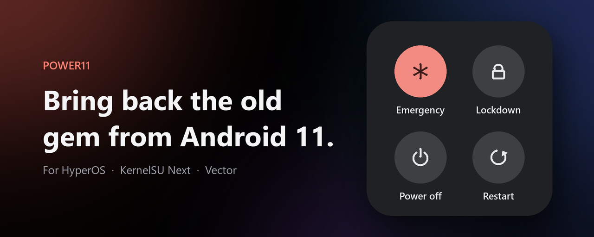

# Power11

**Bring back the old gem from Android 11.** A KernelSU Next module that
replaces the HyperOS / MIUI power menu with the classic AOSP one, and lets you
choose exactly what goes in it.

## Features

- **AOSP power menu** on HyperOS / MIUI
- **Any items, any order**: Recovery, Restart, Bootloader, Power off, SystemUI,
  Soft reboot, Emergency, Lockdown, Screenshot, Airplane mode, Sound mode,
  Settings, Bug report. Drag to reorder.
- **Grid**: 2 or 3 columns, presets *Essential 2×2* and *All-in 2×3*
- **Blur** behind the menu, with adjustable strength
- **WebUI** with a live preview; changes apply the next time you open the menu
- Survives OTA updates and uninstalls cleanly

## Requirements

- KernelSU Next
- [Vector](https://github.com/JingMatrix/Vector) or LSPosed, for custom items
  and order (the AOSP menu itself works without it)

## Install

1. Download the latest zip from [Releases](https://github.com/LuigiColantuono/Power11/releases/latest),
   then KernelSU Next → Modules → Install from storage, and reboot.
2. Vector → Modules → enable **Power11**, scope **System UI**.
3. Power11 WebUI → *Restart* SystemUI, then pick your items.

Updating from *AOSP Power Menu* (v1/v2)? Just install Power11: it replaces the
old module and keeps your settings. Later updates show up in KernelSU Next
automatically.

## How it works

| Part | What it does |
|---|---|
| `power11.sh` | Disables the `miui.systemui.plugin` service bound to `PLUGIN_GLOBAL_ACTIONS`, so SystemUI falls back to its AOSP `GlobalActionsDialogLite` |
| Power11 APK (installed as a regular app) | Vector hook in SystemUI: sets the item list and order, grid columns, and adds the reboot entries. Reads `Settings.Global power11_items` / `power11_columns` on every menu open |
| `watcher.sh` | SystemUI may not reboot to recovery/bootloader. The hook creates `power11_<cmd>` in SystemUI's data dir and this root process (busybox `inotifyd`, no polling) runs it |

## Command line

```sh
su -c sh /data/adb/modules/power11/power11.sh help
```

## Build

Requirements: Python 3 with Pillow, a JDK, and the Android SDK (build-tools and
one platform) in `ANDROID_HOME`.

```sh
python build.py --all
```

## Preview


## Notes

- Lockdown only appears if it is enabled in the lock screen settings.
- If the WebUI says *Plugin not found*, this HyperOS build does not expose the
  power menu as a SystemUI plugin.
- Config and logs: `/data/adb/power11/`.

## Credits

Made by **Luigi Colantuono**.

## License

[MIT](LICENSE)
